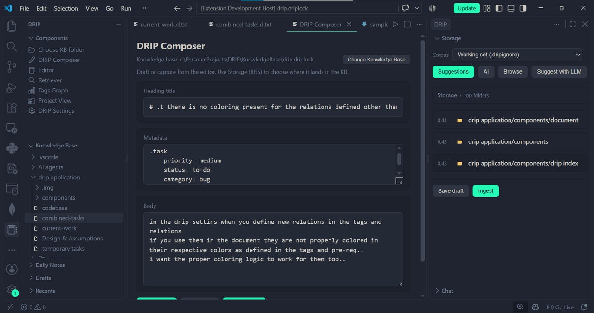
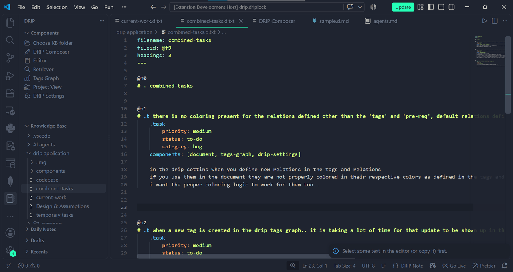

# DRIP 🧠

**Plain-text notes. Structured thinking. Zero AI required.**

DRIP is a note-taking and project-tracking workspace that lives inside VS Code. Capture a thought in seconds, file it into a **project → feature → issue** structure, and find it again instantly. Every note is plain text on *your* disk, everything runs locally, and none of the core experience needs an LLM, a cloud account, or an API key.

> Your knowledge, your files, your machine — no lock-in, no cloud, no AI in the way.

---

## Why DRIP?

Notes and ideas have a way of piling up — scattered across loose files, chat threads, and sticky notes — until you can't find the one thing you're looking for. DRIP gives that a home:

- 🧩 **Everything has a place** — ideas are organized into projects, features, and issues, so you always know what exists and what's next.
- 📝 **Plain text, always yours** — notes are readable `.d.txt` / `.d.md` files in a folder on your disk. No proprietary format, no database you can't open.
- ⚡ **Capture in a keystroke** — grab a selection or your clipboard into a note without leaving the editor.
- 🔎 **Find anything in seconds** — a local index makes search, sorting, and backlinks instant.
- 🚫 **No AI required** — the whole workflow is local and private. Optional AI layers exist, but they're off by default and never a prerequisite.

---

## ✨ What you get

### 📥 Effortless capture
- **Quick Capture** (`Ctrl+U`) opens the Composer to draft a note in seconds.
- **Capture selection / clipboard** (`Ctrl+Shift+U`) sends text straight from your editor.
- DRIP suggests the best place for a note — merge, append, or a new heading — so filing takes one click, not a decision.

### 🗂️ Structured knowledge, not a junk drawer
- A **Knowledge Base** folder tree with drag-drop, filtering, and full create/rename/delete.
- **Projects → Features → Issues**, a Linear-style hierarchy so work is grouped the way you actually think about it.
- Notes carry **metadata, tags, and relations** with stable IDs that survive renames — links don't break.

### 🏷️ Connected by design
- A **Tags graph** shows how notes relate to each other.
- **Backlinks and references** keep related notes one hop away.
- **Daily Notes, Drafts, and Recents** make day-to-day jotting frictionless.

### ✍️ A real writing experience
- A **rich Markdown editor** for `.d.md` files with DRIP-aware rendering of metadata and tags.
- **Colored, structured headings** for `.d.txt` notes with autocomplete, diagnostics, and quick fixes.

### 🔒 Local & private
- A fast **local SQLite index** — nothing leaves your machine.
- **Semantic search, always on** — DRIP embeds your notes with a free local model, so you can find content by *meaning*, not just exact words. No API key, no cloud, no cost.
- **GitHub backup** — one-click push/pull of your whole KB when you want a remote copy.
- **Optional AI extras** — an LLM chat with memory and a local **MCP server** so any AI app can manage issues. Both off by default, and the core experience never needs them.

---

## 🚀 Getting started

1. **Install** DRIP from the VS Code Marketplace.
2. Open the **DRIP** activity bar (the notebook icon on the left).
3. Click **Select Knowledge Base** and choose a `.driplock` folder.
4. Create notes, projects, and features from the **New** menu.
5. Press `Ctrl+U` to capture a thought, or `Ctrl+Shift+U` to grab a selection.

That's it — your first note is already filed and searchable.

---

## ⌨️ Keyboard shortcuts

| Action | Shortcut |
|--------|----------|
| Open Composer | `Ctrl+U` |
| Capture selection / clipboard | `Ctrl+Shift+U` |
| Open Retriever (search) | `Ctrl+Shift+Alt+R` |
| Quick jump to a heading | `Ctrl+Shift+Alt+H` |

---

## 📦 Why plain text?

Your knowledge outlives any app. Because DRIP stores everything as plain `.d.txt` and `.d.md` files, you can read, edit, or migrate your notes with any tool — even without DRIP installed. DRIP adds structure and speed on top, but it never owns your data.

